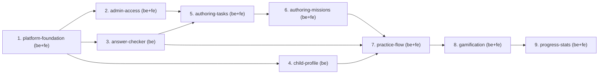

# MVP Capability Change Plan

**Step 4 of the SDD process.** The MVP is split into capability slices that
the delivery loop executes one by one. Doučko is delivered across **three
repos**, so every slice names the repos that implement it, and every MVP
requirement names its **owner repo(s)**. The gate scripts read that column.

> Inputs: `docs/product-brief.md`, `docs/requirements.md`, the product specs
> under `openspec/specs/`, and `api/openapi.yaml` v0.5.1 (change
> `add-api-contract-v0`). This plan lives in the docs repo. The code repos
> read it through their pinned `contract/` submodule.
>
> Status: **approved at checkpoint 2**, 2026-10-03, as drafted, with the
> §7 recommendations accepted (`docs/qa/checkpoint-2-plan-signoff.md`).

## 1. Slicing principles

1. One slice ≈ one cohesive capability that can be designed, built, tested
   and archived as a unit **per repo**. A slice that spans repos becomes one
   implementation change per repo (`implement-<slice>-api` in backend,
   `implement-<slice>-ui` in frontend). Both cite the same store spec.
2. Contract first. The whole MVP contract is already drafted (v0.5, 46
   operations), so no slice starts with a contract change. A slice that
   finds a gap opens a store change (spec delta + `api/openapi.yaml`),
   archives it, and bumps the `contract/` pin before code.
3. Dependency order: foundations first, and no slice depends on one that
   ships after it.
4. One owner slice per requirement (no gaps, no duplicates), and one or more
   owner **repos** per requirement (§5). Domain-bound NFRs travel with their
   domain. Cross-cutting NFRs get one owner slice that builds the
   **mechanism**, and every later slice honors it (§2.1).
5. A requirement's owner repos are the repos that implement it. At least one
   owner must prove each declared Verification method: backend proves only
   `local-verifiable`; frontend proves `local-verifiable, e2e, recording,
   vision-verify, a11y, eval`. So every `e2e`, `recording`, `vision-verify`
   or `a11y` row lists `frontend`.
6. Naming: kebab-case. Product and contract changes live in the store;
   implementation changes live in the code repos.

## 2. The capability slices

| # | Slice | Store spec(s) | Repo(s) → change id | MVP FRs | NFRs travelled | Depends on | Parallel |
|---|---|---|---|---|---|---|---|
| 1 | platform-foundation | admin-access (local network), gamification (theme), content-authoring (CA-D21) | backend → `implement-platform-foundation-api`; frontend → `implement-platform-foundation-ui` | FR-58 | NFR-2, NFR-3, NFR-4, NFR-6, NFR-9, NFR-10, NFR-11, NFR-12, NFR-13 (all as owner, §2.1) | — | serialize (Flyway baseline) |
| 2 | admin-access | admin-access | backend → `implement-admin-access-api`; frontend → `implement-admin-access-ui` | — | NFR-1, NFR-15, NFR-16 | 1 | parallel-safe (no migration) |
| 3 | answer-checker | answer-checking | backend → `implement-answer-checking-api` | FR-14, FR-15, FR-16, FR-17, FR-18, FR-19, FR-20, FR-21, FR-23 | NFR-4 (golden table is self-authored), NFR-5 (checker share of the budget) | 1 | parallel-safe (pure module, no migration) |
| 4 | child-profile | child-profile | backend → `implement-child-profile-api` | FR-43 | NFR-3 (display name) | 1 | serialize (migration) |
| 5 | authoring-tasks | content-authoring | backend → `implement-authoring-tasks-api`; frontend → `implement-authoring-tasks-ui` | FR-1, FR-2, FR-3, FR-4, FR-5, FR-6, FR-7, FR-8, FR-10, FR-11, FR-13 | NFR-8, NFR-17 | 2, 3 | serialize (migration) |
| 6 | authoring-missions | content-authoring | backend → `implement-authoring-missions-api`; frontend → `implement-authoring-missions-ui` | FR-9, FR-12, FR-55, FR-56, FR-57 | — | 5 | serialize (migration) |
| 7 | practice-flow | practice-flow, progress-stats (attempt log) | backend → `implement-practice-flow-api`; frontend → `implement-practice-flow-ui` | FR-22, FR-24, FR-25, FR-26, FR-27, FR-28, FR-29, FR-30, FR-31, FR-42, FR-44 | NFR-5, NFR-7 | 3, 4, 6 | serialize (migration) |
| 8 | gamification | gamification, practice-flow (summary, replay) | backend → `implement-gamification-api`; frontend → `implement-gamification-ui` | FR-32, FR-33, FR-34, FR-35, FR-36, FR-37, FR-38, FR-39 | — | 7 | serialize (migration) |
| 9 | progress-stats | progress-stats | backend → `implement-progress-stats-api`; frontend → `implement-progress-stats-ui` | FR-40, FR-41 | — | 8 | serialize (migration) |

**Parallel** = `parallel-safe` (disjoint modules and no shared migration, so
it may run concurrently in a worktree) or `serialize` (touches Flyway
migrations). The backend and frontend changes of one slice run in parallel
once the contract is pinned.

**Cross-cutting NFRs every change MUST honor:** NFR-2 (LAN-only binding),
NFR-3 (no child PII in repos, fixtures, logs, screenshots or recordings),
NFR-4 (no workbook content; every fixture listed in the provenance manifest),
NFR-6 (Chrome, Edge, Firefox at ≥ 1280×720), NFR-9 (no hard-coded UI
strings; child UI Czech, admin UI English), NFR-11 (module boundaries),
NFR-12 (generated contract code only, never hand-edited), NFR-13 (WCAG AA in
light and dark, reduced motion). Each one has an owner mechanism, built in
slice 1 and listed in §2.1. A later slice honors it by keeping that check
green and adding its own screens and routes to it.

### 2.1 Owners for the deferred cross-cutting NFRs

The Phase 2 specs deliberately left these scopes out (cross-check records:
`trace/workflow-runs/20261003-052439-spec-crosscheck.json` and later rounds).
They are owned here. "Mechanism" is the executable check that
`check-acceptance-methods` resolves. "Extended by" names the slices that must
add their surface to that check.

| NFR scope (deferred by the specs) | Owner slice | Repo(s) | Mechanism (built in the owner slice) | Extended by |
|---|---|---|---|---|
| NFR-3: PII beyond the display name: report notes and raw answers in logs, e2e seeds, screenshots and recordings | platform-foundation | backend, frontend | backend: logging policy (no request bodies, answers, notes or display name at any level) plus a test that captures the logs of a full attempt and report and greps for the submitted values. frontend: e2e and recording seeds use a fictional display name from a fixture, and a check fails if a captured page shows the env display name. | 4, 7, 9 (each adds its endpoints to the log-capture test) |
| NFR-4: copyright beyond authoring fixtures: the golden table, seeded e2e content, skin assets | platform-foundation | backend, frontend | CA-D21 provenance manifest per code repo (`fixtures/PROVENANCE.md`) plus a check that fails on any unlisted fixture, seed or asset file. Font licences (OFL) and self-made icons are listed. | 3 (golden table), 5–9 (seeds) |
| NFR-6: browser and viewport compatibility | platform-foundation | frontend | Playwright projects `chromium`, `msedge`, `firefox` at 1280×720 in `playwright.config.ts`. A smoke spec runs on all three from slice 1, and the full suite runs on all three at G5. | every UI slice (its e2e specs run in all three projects) |
| NFR-9: externalization of the child UI, and of admin screens outside authoring (sign-in, stats, flag queue) | platform-foundation | backend, frontend | frontend: message catalogs (`cs` child, `en` admin) plus a lint rule that forbids literal JSX text and literal `aria-*` and `title` strings outside the catalogs. A test renders every route with a `⟦`-prefixed catalog and asserts that every visible string starts with `⟦` (the content-authoring scenario, generalized). backend: Czech format tips and problem `title` and `detail` come from `messages*.properties`, checked by a test. Task locales are configuration (child-profile). | 2 (sign-in), 5–9 (their routes join the `⟦` render test) |
| NFR-10: Docker volume and cross-platform backup | platform-foundation | backend | `compose.yaml` (Postgres 16 with named volume `doucko-pgdata`, backend, nginx frontend) and `npm run backup` / `npm run restore` (Node scripts around `docker compose exec pg_dump`), with an integration test that backs up, restarts the containers and restores. Run on Windows. | — |
| NFR-11: module boundaries verified by tests | platform-foundation | backend | `ModularityTest` (Spring Modulith `verify()`, already present) plus one named module per slice. Cross-module calls go only through exposed APIs and events. | 2–9 (each adds its module) |
| NFR-12: contract drift fails the build | platform-foundation | backend, frontend | backend: `openapi-generator-maven-plugin` generates the interfaces from the pinned `contract/api/openapi.yaml` into `target/` and controllers implement them, so drift is a compile error. frontend: `api:generate` writes the gitignored `src/api/generated`, and `typecheck` and `build` fail on drift. CI fails when `contract/` is not pinned. | every slice |
| NFR-13: WCAG AA contrast and reduced motion outside the gamification child screens, admin UI included | platform-foundation | frontend | `check-a11y` (axe, light and dark) over a route list that starts with the app shell, plus a global `prefers-reduced-motion` rule in the design system. Gamification keeps its own contrast scenario for HQ, the task screen and the summary. | 2, 5–9 (each adds its routes to the a11y route list) |
| NFR-9 admin half inside authoring | authoring-tasks | frontend | the content-authoring "Externalized admin strings" scenario, on the slice 1 mechanism | — |

## 3. Dependency graph

**Critical path:** 1 → 2 → 5 → 6 → 7 → 8 → 9.
**Parallelizable:** 2, 3 and 4 after 1 (3 is migration-free and 2 has no
migration, so only 4 serializes on Flyway). Within every slice, backend and
frontend run in parallel once the contract is pinned.

## 4. Per-slice scope and exit criteria

### 4.1 `platform-foundation`

- **Scope in:** the owner mechanisms of §2.1. Compose stack bound to
  `127.0.0.1`/LAN (NFR-2), Flyway baseline, backup and restore, contract
  pin and generators wired, module skeleton, i18n catalogs and lint, a11y
  route gate, Playwright browser projects, provenance manifest, logging
  policy. Frontend app shell with OS light/dark theme and no toggle (FR-58).
- **Scope out:** any product endpoint or screen beyond the shell.
- **Contract impact:** none (consumes v0.5.1).
- **Definition of done:** backend: `mvnw verify` green with the generator
  on the pinned contract, `ModularityTest` green, backup/restore test green
  on Windows, log-policy test green. frontend: `npm run qa:verify` green,
  smoke e2e green in chromium, msedge and firefox, `check-a11y` light and
  dark green on the shell, FR-58 e2e (emulated dark and light) green, the
  i18n `⟦` test green. Both: provenance check green and `check-acceptance-methods
  --mode=existence` PASS.
- **Risks:** where the compose file lives (decision D-P1, §7).

### 4.2 `admin-access`

- **Scope in:** form sign-in, session cookie (HttpOnly, SameSite=Strict),
  CSRF on admin mutations, 8 h idle expiry, password policy at startup
  (12 chars to 72 bytes), child endpoints unable to change content, sign-in
  screen (English, externalized).
- **Scope out:** lockout (spec), multiple admins.
- **Contract impact:** none (`/api/admin/session`).
- **Definition of done:** backend tests for each admin-access scenario
  (401/403 paths, cookie flags, idle expiry with a clock, startup refusal).
  frontend: sign-in route in the a11y gate and the `⟦` render test.
- **Risks:** none open.

### 4.3 `answer-checker`

- **Scope in:** the pure checker module: integers, decimals, fractions,
  units, choice, text, alternatives, tolerance, UNPARSEABLE with format tips;
  golden table of ≥ 150 self-authored cases (FR-23), listed in the
  provenance manifest.
- **Scope out:** attempt bookkeeping (slice 7), the admin tester UI (slice 5).
- **Contract impact:** none.
- **Definition of done:** golden table green and counted ≥ 150; every
  scenario input of the listed requirements is a golden case (answer-checking
  "Golden table"); checker p95 well under the NFR-5 300 ms budget in a
  micro-benchmark test; the module has no Spring or DB dependency (ArchUnit
  or Modulith).
- **Risks:** none open.

### 4.4 `child-profile`

- **Scope in:** single profile created from env on first start, display-name
  validation and startup refusal, settings get and patch (absent vs null,
  `GUIDED` → 422), configured task locales.
- **Scope out:** any UI (the translation toggle that calls it is slice 7).
- **Contract impact:** none.
- **Definition of done:** backend tests per scenario, including `answerMode:
  null` → 400 (`Nulls.FAIL`) and the display name absent from logs (NFR-3
  log test).
- **Risks:** none open.

### 4.5 `authoring-tasks`

- **Scope in:** PDF sources (upload, metadata, viewer and page jump), tasks
  with parts, answer specs, hints, translations and images, filters and
  search, preview and answer tester, provenance links. Field limits,
  upload limits (NFR-17), bulk publish (OQ-32).
- **Scope out:** missions and publishing rules (slice 6).
- **Contract impact:** none.
- **Definition of done:** backend tests per content-authoring scenario in
  scope; frontend e2e per FR (FR-1, 2, 3, 4, 10, 11, 13); NFR-8 recording of
  entering a typical single-part task in ≤ 60 s; uploaded files stored
  outside every repo working tree; authoring routes in the a11y and `⟦` gates.
- **Risks:** the largest slice. If it runs long, split the frontend change
  into `-ui-sources` and `-ui-tasks` without changing ownership.

### 4.6 `authoring-missions`

- **Scope in:** missions (topic, position, ordered tasks, 50 max), publish
  and unpublish rules (FR-12, FR-57, CA-D6..D10), editing every entity
  (FR-55), and delete rules (FR-56, CA-D4, CA-D22 if approved).
- **Scope out:** child-side serving (slice 7 consumes the "served" query).
- **Contract impact:** none.
- **Definition of done:** backend tests per publishing and delete scenario.
  The "referenced by attempts, reports or hints" guard goes through a
  content-module port (`ContentUsage`) that slice 7 implements, and is tested
  here with a fake. frontend e2e for FR-9 and FR-55.
- **Risks:** none open (CA-D22 accepted at checkpoint 2).

### 4.7 `practice-flow`

- **Scope in:** HQ without login, mission list, task screen, attempts and
  reveal, UNPARSEABLE without cost (FR-22), hints, translation toggle
  (settings from slice 4), report a problem, save and resume, attempt log
  (FR-42), tutor seam (FR-44), oversized input, `ContentUsage` port.
- **Scope out:** XP, ranks, mission summary and replay (slice 8).
- **Contract impact:** none.
- **Definition of done:** backend tests per scenario; frontend e2e per FR;
  NFR-5 measured (check round trip p95 < 300 ms, task screen < 1.5 s) in an
  e2e timing test; NFR-7 (2 clicks, Enter submits) e2e; the log-capture test
  covers attempts and reports (NFR-3); the admin-access scenario "Child write
  is limited to its own practice" (NFR-1), deferred from slice 2, gets a
  backend test.
- **Risks:** `AttemptResult` carries XP fields that slice 8 fills. Until
  then the backend returns 0 / [] / null, which the contract allows.

### 4.8 `gamification`

- **Scope in:** XP and hint costs, completion bonus and shared-task
  completion (OQ-28), rank ladder from the skin, rank-up celebration
  (one-shot, `ackRankUp`), HQ progress, mission-complete screen (FR-32),
  replay (FR-33), no negative mechanics, swappable skin.
- **Scope out:** in-app theme toggle (FR-58 has none).
- **Contract impact:** none.
- **Definition of done:** backend XP and bonus tests; frontend e2e for
  FR-32 and FR-37 and a recording for FR-32; vision-verify for the rank-up
  celebration and HQ (FR-36, FR-37); the reduced-motion variant covered in
  the a11y gate.
- **Risks:** none open.

### 4.9 `progress-stats`

- **Scope in:** stats page (sessions, tasks per session, first-try rate,
  hints, reveals, success metric), flag queue, re-evaluation (only adds XP,
  can raise a pending rank-up), dismiss.
- **Scope out:** export, charts beyond the spec.
- **Contract impact:** none.
- **Definition of done:** backend tests for the session definition and week
  boundaries (Europe/Prague) and for re-evaluation; frontend e2e for FR-40
  and FR-41; stats and queue routes in the a11y and `⟦` gates.
- **Risks:** none open.

## 5. Requirement coverage and repo ownership

**Machine-read** by `check-traceability`, `check-acceptance-methods` (code
repos audit only the ids they own) and `check-workspace` (the cross-repo
join). One requirement per row. Owner values: `backend`, `frontend`, `docs`.

| Req | Slice | Repo(s) |
|---|---|---|
| FR-1 | authoring-tasks | backend, frontend |
| FR-2 | authoring-tasks | backend, frontend |
| FR-3 | authoring-tasks | backend, frontend |
| FR-4 | authoring-tasks | backend, frontend |
| FR-5 | authoring-tasks | backend |
| FR-6 | authoring-tasks | backend, frontend |
| FR-7 | authoring-tasks | backend, frontend |
| FR-8 | authoring-tasks | backend, frontend |
| FR-9 | authoring-missions | backend, frontend |
| FR-10 | authoring-tasks | backend, frontend |
| FR-11 | authoring-tasks | backend, frontend |
| FR-12 | authoring-missions | backend |
| FR-13 | authoring-tasks | backend, frontend |
| FR-14 | answer-checker | backend |
| FR-15 | answer-checker | backend |
| FR-16 | answer-checker | backend |
| FR-17 | answer-checker | backend |
| FR-18 | answer-checker | backend |
| FR-19 | answer-checker | backend |
| FR-20 | answer-checker | backend |
| FR-21 | answer-checker | backend |
| FR-22 | practice-flow | backend, frontend |
| FR-23 | answer-checker | backend |
| FR-24 | practice-flow | backend, frontend |
| FR-25 | practice-flow | backend, frontend |
| FR-26 | practice-flow | backend, frontend |
| FR-27 | practice-flow | backend, frontend |
| FR-28 | practice-flow | backend, frontend |
| FR-29 | practice-flow | backend, frontend |
| FR-30 | practice-flow | backend, frontend |
| FR-31 | practice-flow | backend, frontend |
| FR-32 | gamification | backend, frontend |
| FR-33 | gamification | backend, frontend |
| FR-34 | gamification | backend |
| FR-35 | gamification | backend |
| FR-36 | gamification | backend, frontend |
| FR-37 | gamification | backend, frontend |
| FR-38 | gamification | backend, frontend |
| FR-39 | gamification | backend, frontend |
| FR-40 | progress-stats | backend, frontend |
| FR-41 | progress-stats | backend, frontend |
| FR-42 | practice-flow | backend |
| FR-43 | child-profile | backend |
| FR-44 | practice-flow | backend |
| FR-55 | authoring-missions | backend, frontend |
| FR-56 | authoring-missions | backend |
| FR-57 | authoring-missions | backend |
| FR-58 | platform-foundation | frontend |
| NFR-1 | admin-access | backend |
| NFR-2 | platform-foundation | backend |
| NFR-3 | platform-foundation | backend, frontend |
| NFR-4 | platform-foundation | backend, frontend |
| NFR-5 | practice-flow | backend, frontend |
| NFR-6 | platform-foundation | frontend |
| NFR-7 | practice-flow | frontend |
| NFR-8 | authoring-tasks | frontend |
| NFR-9 | platform-foundation | backend, frontend |
| NFR-10 | platform-foundation | backend |
| NFR-11 | platform-foundation | backend |
| NFR-12 | platform-foundation | backend, frontend |
| NFR-13 | platform-foundation | frontend |
| NFR-15 | admin-access | backend |
| NFR-16 | admin-access | backend |
| NFR-17 | authoring-tasks | backend, frontend |

Total: **48 MVP FRs and 16 MVP NFRs across 9 slices** (no gaps, no
duplicates). NFR-14 is Future and is not planned.

## 6. Sequencing

Implement in dependency order (§3). After each archive, in the repo that
archived: `npm run qa:verify`. In the docs repo: `node scripts/check-workspace.mjs`.
Future-phase work (FR-45..FR-54, NFR-14) is NOT in this plan.

## 7. Decisions taken at checkpoint 2

The product owner accepted every recommendation on 2026-10-03.

| # | Decision | Accepted recommendation |
|---|---|---|
| D-P1 | Where the Compose stack and `npm run backup` live | **backend repo** (`compose.yaml`, `scripts/backup.mjs`). It owns Postgres, Flyway and the volume, and NFR-10 is `local-verifiable`, which backend proves. The nginx frontend service builds from the sibling `../frontend`. Frontend e2e starts the stack via `docker compose -f ../backend/compose.yaml`. |
| D-P2 | How to pin `contract/` while no remote exists | a submodule with the **relative URL `../docs`** in both code repos. Locally it resolves to the sibling checkout. Once remotes exist with matching names, it resolves on the host without editing `.gitmodules`. |
| D-P3 | CA-D22: reports and opened hints block deletion (narrows FR-56) | accept (`docs/requirements.md` §6.7) |
| D-P4 | Slice granularity: 9 slices; content authoring split into tasks and missions | accept |
