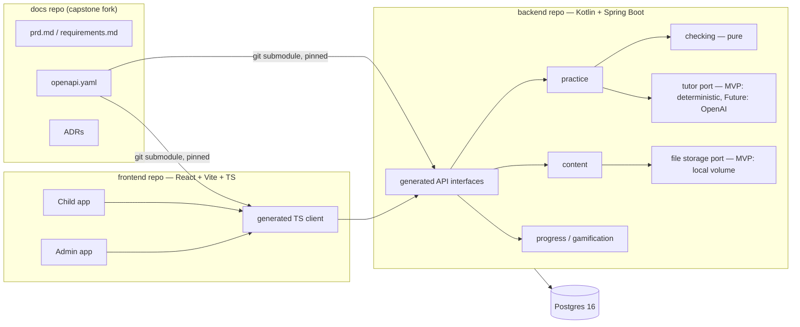

# PRD — "Doučko" (working title): a home math tutor for a Czech 6th-grader

| | |
|---|---|
| **Status** | Draft v0.2 — Maven, theme decided, SDD tooling recommendation added |
| **Owner** | Product owner / sole developer (parent) |
| **Date** | 2026-09-28 |
| **MVP target** | 1 week, solo |
| **Repos** | `docs` (capstone fork) · `backend` (Kotlin/Spring Boot) · `frontend` (React/Vite/TS) |

> Requirement IDs (`FR-x`, `NFR-x`, `TC-x`, `BC-x`) follow the Project Factory
> `requirements.template.md` convention and carry a Verification tag from its
> closed vocabulary (`local-verifiable`, `vision-verify`, `recording`, `e2e`,
> `a11y`, `eval`, `deploy-gated`). IDs are assigned once and never renumbered.

---

## 1. Vision

A home tutor for a child at a Czech primary school (ZŠ). In the long run it acts like a
patient private tutor: it never just hands over answers, it leads the child to the
solution with questions (the Socratic method), explains the material when needed, and
teaches her to think.

We get there in stages:

1. **MVP (this PRD's delivery scope):** no AI. The child solves tasks from a curated
   database, and the system checks her answer against a stored answer key. She gets
   2 attempts, then the answer is revealed. Optional hand-written hints can be added.
   Progress is shown as a game.
2. **AI Phase 1:** the answer is still checked deterministically. When it is wrong, an
   OpenAI model explains it like a tutor would.
3. **AI Phase 2:** a **Guided mode** where an AI tutor leads the child to the answer
   step by step without revealing it. The child chooses per task (or per session):
   "I'll answer directly" or "guide me."

## 2. Problem

- Homework and practice happen on paper. A parent must check every answer, and
  immediate feedback is missing.
- The child's father speaks Ukrainian. Tasks are in Czech, so helping is harder
  without a side-by-side translation.
- Plain practice is boring for a 12-year-old. Motivation drops quickly, and she prefers
  anime/manga-style aesthetics (hero academy, spy stories).
- Existing platforms either give answers away or don't follow the Czech curriculum
  and workbook the class actually uses.

## 3. Goals and non-goals

### Goals (MVP)

- G1. The child practices grade-6 math tasks on a laptop and gets instant, **correct**
  feedback.
- G2. Practicing feels like a game: **missions + XP + rank**.
- G3. The parent can load tasks quickly from a workbook PDF: a PDF reference with a web
  form next to it, where each task records its source.
- G4. Task text can be shown in Ukrainian next to Czech, from translations stored in
  the DB.
- G5. The architecture already contains the seams for AI tutoring, multiple languages,
  multiple children, and answer modes, so later phases add code and don't require
  rewrites.

### Non-goals (MVP)

- AI of any kind (checking, hints, translation, PDF extraction).
- Tasks that need a graphic answer (constructions, drawing, coloring). They can be
  stored, but they are never served to the child.
- Child login, multiple children, parent accounts, and teacher roles.
- Public hosting, mobile layouts, and payments.
- Subjects other than math, and grades other than 6.

## 4. Users

| Persona | Description | Needs |
|---|---|---|
| **Child (primary user)** | 12-year-old girl, grade 6 at a Czech ZŠ. Uses a laptop. Likes manga/anime (hero-academy and spy-comedy genres). | Short, satisfying sessions. Clear feedback. A sense of progress. Not "baby" visuals. |
| **Admin / parent (content author)** | Developer parent. Enters tasks from the workbook. | Fast, keyboard-friendly task entry next to the PDF. The ability to test an answer key before publishing. Stats on whether practice happens. |
| **Helper (father)** | Ukrainian speaker. Practices together with the child. | Ukrainian translation of the task text shown next to the Czech original. |

## 5. Success metrics

The primary metric (agreed with the child) is **"she does 10 tasks from the current
chapter on the site instead of on paper, 3 times a week, for 4 weeks."**

| Metric | Target | Source |
|---|---|---|
| Sessions per week with ≥10 answered tasks | ≥ 3, for 4 consecutive weeks | `attempt` log (Europe/Prague week) |
| Checker false negatives (correct answer marked wrong) | 0 unresolved; every child "I'm right" flag triaged within 2 days | `flag` table |
| First-attempt correct rate per topic | Tracked, no target (diagnostic) | `task_result` |
| Hint usage per task | Tracked (feeds the AI-phase design) | `attempt.hints_used` |

## 6. Scope overview

| Area | MVP | Future |
|---|---|---|
| Content | PDF sources, manual task entry, images, multi-part tasks, hints, translations, missions | AI extraction from PDF (RAG/vision), AI-drafted hints and translations with review, in-app cropping |
| Checking | Deterministic checker (numbers, decimals, fractions, units, choices, short text) | AI explanation of mistakes, graphic answers |
| Practice | 2 attempts → reveal, on-demand hints, UK translation toggle, report a problem | Guided (Socratic) AI mode, spaced-repetition review missions |
| Gamification | Missions, XP, ranks, themed skin | Achievements, cosmetics, streaks (non-punishing) |
| Users | One hardcoded child profile, password-protected admin | Child login, multiple children, parent accounts |
| Languages | Czech UI; task text in cs + uk | ru and others, added by configuration and data only |
| Runtime | Docker Compose on the home laptop | Public hosting (requires content licensing) |

---

## 7. Functional requirements

### 7.1 Content management (admin)

| ID | Phase | Area | Description | Verification |
|---|---|---|---|---|
| FR-1 | MVP | Content | Admin uploads a PDF **source** with metadata: title, publisher, edition, grade, and subject. | local-verifiable, e2e |
| FR-2 | MVP | Content | Admin views an uploaded PDF page by page, side by side with the task editor, and can jump to a page number. | e2e |
| FR-3 | MVP | Content | Admin creates a task with: Czech prompt text, topic, grade, difficulty (1–3), and **source reference** (source, page, task number, optional sub-part). | e2e |
| FR-4 | MVP | Content | Admin attaches 0..n images (PNG/JPG, cropped outside the app) to a task. Images are shown to the child with the task. | e2e |
| FR-5 | MVP | Content | Every task has an **answer modality**: `TEXT` or `GRAPHIC`. `GRAPHIC` tasks are never served to the child in MVP. | local-verifiable |
| FR-6 | MVP | Content | A task has 1..n **answer parts** (e.g. a, b, c). Each part has a label and its own answer spec (see 7.2). | local-verifiable |
| FR-7 | MVP | Content | Admin adds 0..n ordered hints per task. Tasks without hints work normally. | local-verifiable |
| FR-8 | MVP | Content | Admin adds translations of prompt, part labels, and hints per locale (`uk` in MVP). Supported locales are configuration, not code. | local-verifiable |
| FR-9 | MVP | Content | Admin creates **missions**: ordered lists of tasks within one topic. The default size is 10 tasks. | e2e |
| FR-10 | MVP | Content | Admin previews a task exactly as the child sees it, and can type test answers to see the checker's verdict and normalized interpretation ("answer tester"). | e2e |
| FR-11 | MVP | Content | Admin filters and searches tasks by grade, topic, source, page, modality, and status. | e2e |
| FR-12 | MVP | Content | Tasks have status `DRAFT` or `PUBLISHED`. Only published tasks in published missions are served to the child. | local-verifiable |
| FR-13 | MVP | Content | Given any task, admin can see where it came from (source title, edition, page, task number) and open the PDF at that page. | e2e |

### 7.2 Answer checking (deterministic checker)

The checker is a pure, side-effect-free domain module. Given an answer spec and raw
input, it returns a per-part verdict (`CORRECT` / `WRONG` / `UNPARSEABLE`) and the
normalized interpretation of the input.

| ID | Phase | Area | Description | Verification |
|---|---|---|---|---|
| FR-14 | MVP | Checking | **Integers:** leading and trailing whitespace, a leading `+`, and thousands separators (space, NBSP, thin space) are ignored. `1 000` = `1000`. | local-verifiable |
| FR-15 | MVP | Checking | **Decimals:** comma and dot are equivalent, and equality is numeric (`0,50` = `0,5` = `.5`), unless the part requires exact form (e.g. "round to 2 decimal places" → `0,50` is required). | local-verifiable |
| FR-16 | MVP | Checking | **Fractions:** `a/b` input is accepted. If the part allows it, equivalent forms count (`1/2` = `0,5` = `2/4`). A per-part flag `requireLowestTerms` rejects `2/4` when `1/2` is expected. Mixed numbers (`1 1/2`) are parsed. | local-verifiable |
| FR-17 | MVP | Checking | **Numbers with units:** the unit is normalized (`cm2` = `cm²` = `cm^2`; spacing ignored). A per-part flag sets whether the unit is required. **No unit conversion**: the answer must be in the unit the task asks for. | local-verifiable |
| FR-18 | MVP | Checking | **Multiple choice:** single- and multi-select. Multi-select is correct only when the set matches exactly. | local-verifiable |
| FR-19 | MVP | Checking | **Short text** (e.g. "tajenka" puzzles): case-insensitive and whitespace-trimmed. Diacritics-insensitive by default, with a per-part option to be strict. | local-verifiable |
| FR-20 | MVP | Checking | A part can list several accepted alternatives. | local-verifiable |
| FR-21 | MVP | Checking | An optional numeric tolerance can be set per part (default: exact). | local-verifiable |
| FR-22 | MVP | Checking | `UNPARSEABLE` input (e.g. `5,,2`) gets a friendly format message and **does not consume an attempt**. | local-verifiable, e2e |
| FR-23 | MVP | Checking | The checker is covered by a golden table of ≥ 150 input → verdict cases, versioned in the backend repo. | local-verifiable |

### 7.3 Practice flow (child)

| ID | Phase | Area | Description | Verification |
|---|---|---|---|---|
| FR-24 | MVP | Practice | The child opens the app with no login and lands on **HQ** (home) as the single hardcoded profile. | e2e |
| FR-25 | MVP | Practice | HQ lists available missions grouped by topic, each with progress (x/10 solved) and state (new / in progress / complete). | e2e |
| FR-26 | MVP | Practice | The task screen shows the prompt, images, and one input per answer part. The child submits all parts together. | e2e |
| FR-27 | MVP | Practice | **Attempts:** each task allows 2 attempts. After a wrong attempt, the child sees which parts are wrong, but not the correct values. After the 2nd wrong attempt, the correct answer for every part is **revealed** and the task is marked `REVEALED`. | local-verifiable, e2e |
| FR-28 | MVP | Practice | **Hints:** if the task has hints, the child can open them one at a time, in order, at any point. Each hint used is recorded. | e2e |
| FR-29 | MVP | Practice | **Translation toggle:** if a `uk` translation exists, the child can show it next to the Czech text ("Zobrazit ukrajinsky"). The UI stays Czech. The toggle state is remembered per profile. | e2e |
| FR-30 | MVP | Practice | **Report a problem:** from any task, the child can flag it with a reason ("Myslím, že moje odpověď je správně" / "Zadání je nejasné" / other + note). The raw attempt is attached. | e2e |
| FR-31 | MVP | Practice | Every attempt is saved immediately. Closing the browser mid-mission resumes at the first unfinished task. | e2e |
| FR-32 | MVP | Practice | A mission-complete screen shows XP earned, first-try count, and any rank-up. | e2e, recording |
| FR-33 | MVP | Practice | Completed missions can be replayed. XP is awarded only for the first resolution of each task. | local-verifiable |

### 7.4 Gamification

| ID | Phase | Area | Description | Verification |
|---|---|---|---|---|
| FR-34 | MVP | Game | **XP** per task, first resolution only: correct on 1st attempt = 10, correct on 2nd = 5, revealed = 1 (effort still counts). Each hint used costs 2, with a minimum of 1. All values are configuration. | local-verifiable |
| FR-35 | MVP | Game | Mission completion bonus: +20 XP (configurable). | local-verifiable |
| FR-36 | MVP | Game | **Ranks:** an ordered list of rank names with XP thresholds, defined in the theme configuration. Rank-up triggers a celebration animation. | local-verifiable, vision-verify |
| FR-37 | MVP | Game | HQ shows the current rank, an XP bar to the next rank, and total solved tasks. | e2e, vision-verify |
| FR-38 | MVP | Game | No negative mechanics: XP is never lost, and there are no timers, streak penalties, or leaderboards. | local-verifiable |
| FR-39 | MVP | Game | The theme (names, ranks, copy, illustrations, colors) is one swappable **skin**. See §9 for the direction. | local-verifiable |

### 7.5 Progress and stats (admin/parent)

| ID | Phase | Area | Description | Verification |
|---|---|---|---|---|
| FR-40 | MVP | Stats | The admin stats page shows sessions per week, tasks per session, first-try rate per topic, hint usage, and revealed tasks. This directly measures §5. | e2e |
| FR-41 | MVP | Stats | The admin flag queue lists child reports with the task, raw input, and checker verdict. Admin can fix the answer spec and **re-evaluate** the attempt (awarding the missing XP) or dismiss the report. | e2e |
| FR-42 | MVP | Stats | The attempt log stores raw input, normalized input, per-part verdicts, hints used, and a timestamp. | local-verifiable |

### 7.6 Settings and forward-compatibility hooks

| ID | Phase | Area | Description | Verification |
|---|---|---|---|---|
| FR-43 | MVP | Settings | The child profile stores settings: `secondaryTaskLocale` (`uk` or none) and `answerMode` (`DIRECT` only in MVP; `GUIDED` exists in the enum and API but is disabled). | local-verifiable |
| FR-44 | MVP | Settings | Feedback after an attempt is produced through a `TutorPort` abstraction. The MVP implementation returns deterministic feedback (verdict, hint pointer, reveal). | local-verifiable |

### 7.7 Future phase (recorded now, not built)

| ID | Phase | Area | Description | Verification |
|---|---|---|---|---|
| FR-45 | Future | AI | After a wrong answer, an AI explanation (OpenAI, backend-only) explains the likely mistake without solving the task outright on the 1st attempt. | eval |
| FR-46 | Future | AI | **Guided mode:** a Socratic dialogue that leads to the answer step by step. The tutor never states the final answer unless the child explicitly gives up. | eval |
| FR-47 | Future | AI | AI-drafted hints and translations enter as `DRAFT` and require admin review before publishing. | eval, e2e |
| FR-48 | Future | AI | PDF → draft task extraction (vision/RAG) with admin review. | eval |
| FR-49 | Future | AI | Explain the underlying topic material on request ("Vysvětli mi to"). | eval |
| FR-50 | Future | Users | Child login, multiple children per family, and parent accounts. | e2e |
| FR-51 | Future | Checking | Graphic answers (constructions, drawing) via a canvas or AI vision check. | eval |
| FR-52 | Future | Content | In-app cropping of task images from the PDF. | e2e |
| FR-53 | Future | Practice | Review missions built from previously failed or revealed tasks (spaced repetition). | local-verifiable |
| FR-54 | Future | Content | More grades and subjects; `ru` and other task locales. | local-verifiable |

---

## 8. Non-functional requirements

| ID | Category | Description | Verification |
|---|---|---|---|
| NFR-1 | Security | Admin UI and admin API require authentication (Spring Security; single admin user, password from env, stored as bcrypt). Child endpoints cannot mutate content. | local-verifiable |
| NFR-2 | Security | In MVP, the stack binds to localhost/LAN only. Nothing is exposed to the internet. | local-verifiable |
| NFR-3 | Privacy | The child's real name, photos, or any PII never appear in any repository, fixture, log, screenshot, or demo recording. The profile display name exists only in the local DB. | local-verifiable |
| NFR-4 | Legal | Copyrighted workbook content (Hravá matematika text, images, and answer keys) is **never committed** to any repository. Test fixtures use self-authored tasks. | local-verifiable |
| NFR-5 | Performance | Answer check round-trip is < 300 ms p95 on the laptop. Task screen loads in < 1.5 s. | local-verifiable, e2e |
| NFR-6 | Compatibility | Current Chrome, Edge, and Firefox on a laptop, ≥ 1280×720. Mobile is not required. | e2e |
| NFR-7 | Usability | The child can start or continue a mission within 2 clicks from HQ. The task screen is fully keyboard-operable (Enter submits). | e2e |
| NFR-8 | Usability | Admin can enter a typical single-part task in ≤ 60 s (keyboard-first form, sticky source and page fields). | eval |
| NFR-9 | Localization | All UI strings are externalized. The child UI is Czech; the admin UI is English (open question). Adding a task locale needs configuration and data only. | local-verifiable |
| NFR-10 | Reliability | Postgres data lives in a Docker volume. A `make backup` (pg_dump) script exists and is documented. Progress survives container restarts. | local-verifiable |
| NFR-11 | Maintainability | The backend is a modular monolith. Module boundaries are verified by tests (Spring Modulith verify or ArchUnit). | local-verifiable |
| NFR-12 | API | The OpenAPI contract is the single source of truth. Generated code is never hand-edited, and a build fails if the implementation drifts from the contract. | local-verifiable |
| NFR-13 | Accessibility | WCAG AA contrast. Animations respect `prefers-reduced-motion`. | a11y |
| NFR-14 | AI (Future) | OpenAI calls are made from the backend only. The key is never exposed to the frontend. There is a monthly budget cap, and prompts contain no PII. Prompts and responses are logged for review. | local-verifiable |

---

## 9. UX and design direction

This section is written for **Claude Design** and the frontend implementer.

### 9.1 Theme

The theme is original and anime-inspired, aimed at a 12-year-old girl. It should
feel bold and stylish, not "kiddie."

- **Direction (decided, D-25):** a **Hero Academy**, inspired by the child's favorite
  manga, *My Hero Academia*. The app captures the genre's feel with original material:
  - She is a first-year student at an original hero school (own name, own crest).
  - Each math topic is a **power** she trains. Missions are training exercises and
    rescue missions.
  - Ranks form a hero-ranking ladder, e.g. Trainee → Sidekick → Pro Hero → Top Hero.
  - A chapter test is a "hero license exam." Cosmetic hero-costume unlocks are a
    Future option.
- **IP rule:** the app draws only on the *genre* (hero schools, powers, hero rankings).
  No MHA characters, names, logos, catchphrases, or MHA-specific terms (e.g. "Quirk,"
  "U.A.," "Plus Ultra") appear anywhere, and no art imitates the manga's
  characters or style closely enough to be recognizable. The mentor/mascot character,
  school name, rank names, and iconography are all original. This keeps the public
  capstone repo clean and lets Claude Design and AI agents work on the skin.
- **Visual language:** manga-panel framing, speed lines, and halftone textures used
  sparingly. Strong accent colors on a calm base. Big, readable math typography. Dark
  and light themes.
- **Tone of copy (Czech):** encouraging and playful, never mocking. A wrong answer is
  "Skoro! Zkus to znovu," not a failure.

### 9.2 Child screens

1. **HQ:** rank badge, XP bar, a "Pokračovat" CTA for the current mission, and the
   mission list by topic.
2. **Mission briefing:** topic, 10 tasks, XP available, and a start button.
3. **Task:** prompt and images, part inputs, a hint button (counter), the UK
   translation toggle, a report-problem link, and an attempt indicator (●○).
4. **Feedback states:** correct (burst animation, +XP), wrong 1st attempt (wrong parts
   highlighted), revealed (correct values shown calmly with "Nevadí, příště!"), and
   unparseable (format tip that doesn't cost an attempt).
5. **Mission complete:** summary, XP tally, and a rank-up celebration.

### 9.3 Admin screens

1. **Sources:** list and upload.
2. **Task editor:** PDF viewer on the left, form on the right. Sticky source and page
   fields; answer parts with type-specific fields; hints; translations tab; images; an
   **answer tester**.
3. **Tasks:** table with filters (FR-11) and a bulk publish action.
4. **Missions:** create, order tasks, publish.
5. **Stats and flag queue** (FR-40, FR-41).

---

## 10. Domain model (conceptual)

```
Source(id, title, publisher, edition, grade, subject, pdfFileRef)
Topic(id, code, grade, nameCs, parentId?)                 -- own taxonomy (open question)
Task(id, topicId, grade, difficulty, modality[TEXT|GRAPHIC], status[DRAFT|PUBLISHED],
     sourceRef{sourceId, page, taskNo, subPart?})
TaskLocalization(taskId, locale, prompt, partLabels{}, hints[])
TaskImage(id, taskId, fileRef, order)
AnswerPart(id, taskId, key["a"], type, spec{...})        -- see FR-14..21
   type ∈ INTEGER | DECIMAL | FRACTION | NUMBER_WITH_UNIT | CHOICE_SINGLE | CHOICE_MULTI | TEXT
Mission(id, topicId, title, order, status, taskIds[])
ChildProfile(id, displayName, settings{secondaryTaskLocale, answerMode})
Attempt(id, childId, taskId, attemptNo, rawInput{}, normalized{}, verdicts{}, hintsUsed, createdAt)
TaskResult(childId, taskId, outcome[FIRST_TRY|SECOND_TRY|REVEALED], xpAwarded, resolvedAt)
XpEvent(id, childId, amount, reason, refId, createdAt)   -- append-only ledger
Flag(id, childId, taskId, attemptId, reason, note, status[OPEN|FIXED|DISMISSED])
```

---

## 11. Architecture overview



The key decisions are listed below. Each should become an ADR in the docs repo.

- **Modular monolith, not microservices.** This is the scalable choice for this size of
  project. Modules have explicit boundaries (NFR-11), so any one of them (e.g. `tutor`)
  can be extracted later. Hexagonal style inside each module.
- **Contract-first API.** `openapi.yaml` lives in the docs repo and is consumed by both
  code repos as a pinned git submodule. The backend uses `openapi-generator-maven-plugin`
  (generator `kotlin-spring`, `interfaceOnly=true`) bound to the `generate-sources` phase. The frontend uses a generated TS client
  (e.g. orval or openapi-typescript) with TanStack Query.
- **Pure checker module.** No Spring dependency. Unit- and property-tested (FR-23).
- **Ports for everything that changes later:** `TutorPort` (AI), `FileStoragePort`
  (S3 later), and `TranslationProvider` (AI drafts later).
- **Persistence:** Postgres 16 with Flyway migrations. Answer specs and attempt payloads
  are stored as JSONB with typed Kotlin models.
- **Runtime:** `docker compose up` runs Postgres, the backend, and the frontend (nginx)
  on the laptop.
- **Build:** Maven (`kotlin-maven-plugin`, Spring Boot parent). `./mvnw verify` is the
  single backend check command: compile, unit, integration, module boundaries, and
  coverage.
- **Testing:** backend uses JUnit 5 / Kotest and Testcontainers (Surefire and Failsafe),
  with JaCoCo coverage and a minimum-coverage rule on the checking module.
  Frontend uses Vitest and Playwright E2E against the compose stack.

### 11.1 Repository and documentation layout

The recommended tooling is OpenSpec with its **Stores** feature (beta). See OQ-10.

- **docs repo** = fork of `2026-agentic-engineering-crash-course-capstone`. It is an
  **OpenSpec store**: it has `.openspec-store/store.yaml` and `openspec/specs/`
  (product-level capability specs), plus `prd.md`, `product-brief.md`,
  `requirements.md`, `architecture.md`, `adr/`, and `api/openapi.yaml`.
  (First check whether a store can live under `submissions/<name>/`. If it must be at
  the repo root, keep it at the root of your branch; the capstone only forbids
  changing the course's own root files.)
- **backend and frontend repos:** each has its own `openspec/` root for
  implementation-level changes, and `openspec/config.yaml` with
  `references: [<docs-store-id>]`. That gives agents a read-only index of the product
  specs without copying them. Each repo also contains `AGENTS.md`, the docs repo as a
  submodule (only so the build can read `openapi.yaml`), and the CI battery.
- A personal `openspec workset` opens all three repos together in the editor.
- Product-level truth lives in docs; implementation plans live next to the code
  (decision D-20).

---

## 12. Constraints

### 12.1 Technical constraints

| ID | Description |
|---|---|
| TC-1 | Backend: Kotlin, Spring Boot 3.x, JVM 21, Maven (with wrapper `mvnw`), Postgres 16, Flyway. |
| TC-2 | Frontend: React, Vite, TypeScript (strict). |
| TC-3 | OpenAPI 3.x contract in the docs repo. Server interfaces and TS client are generated from it. |
| TC-4 | Three repositories: docs, backend, frontend. The contract is consumed via a pinned git submodule. |
| TC-5 | MVP runs via Docker Compose on the home laptop. No cloud, no running cost. |
| TC-6 | No AI/LLM calls in MVP. Future AI goes through the OpenAI API, called from the backend only. |
| TC-7 | SDD tooling: OpenSpec, with Stores/references (beta) across the 3 repos. Project Factory is optional and used partially: its requirements format (this PRD), `AGENTS.md` template, reviewer agent, and hooks. If full Factory gates are adopted, the stack swap (Maven/Kotlin, Vite instead of Next.js) is recorded as an ADR, and gates are mapped to `./mvnw verify` and `npm run check`. |
| TC-8 | Out of scope for MVP: graphic answers, automatic PDF extraction, child authentication, mobile layouts. |

### 12.2 Business constraints

| ID | Description |
|---|---|
| BC-1 | MVP is delivered in 1 week by a solo developer with AI agents. |
| BC-2 | Single user (the author's child), private use only. Workbook content is typed from a purchased copy for private use. Any public launch requires a license from the publisher (TAKTIK International) or fully self-authored content. |
| BC-3 | The project is also a course capstone (fwdays Agentic Engineering). Each practice used must be evidenced per the capstone `RUBRIC.md`: rules, loops, verification, maker ≠ checker, and specs committed before code. |
| BC-4 | Running cost in MVP is zero. Any AI budget is decided before the AI phase. |

---

## 13. Delivery plan (1 week)

| Day | Outcome |
|---|---|
| D1 | Docs repo set up as an OpenSpec store: PRD → brief + requirements, baseline specs, ADRs, `openapi.yaml` v0. Code repos scaffolded with `AGENTS.md`, submodule, compose, and CI skeleton. |
| D2 | Content module and admin UI: sources + PDF viewer, task editor, images, publish. |
| D3 | Checker, test-first from the golden table (red → green), plus the attempts API and answer tester. |
| D4 | Child practice flow: HQ, mission, task screen, attempts/reveal, hints, UK toggle, report problem. |
| D5 | Gamification (XP ledger, ranks, celebrations), stats page, flag queue. |
| D6 | Playwright E2E happy paths, review gates, and real content entry (one chapter, ≥ 30 tasks). First real session with the child. |
| D7 | Fixes from her session, demo video (1–2 min), capstone PR. |

**Cut line if behind:** fall back to fewer answer types (drop mixed numbers and
multi-select), fewer screens (merge mission briefing into HQ), and no rank-up
animation. The checker's correctness and the attempt flow are **never** cut.

---

## 14. Risks

| Risk | Impact | Mitigation |
|---|---|---|
| Checker marks correct answers wrong | Child loses trust fast | Golden table (FR-23), answer tester before publishing (FR-10), report flow with XP re-evaluation (FR-41) |
| Content entry is slow | Not enough tasks for 3 sessions/week | Keyboard-first editor (NFR-8), sticky fields; one chapter at a time; future AI drafting |
| Novelty wears off after week 1 | Metric missed | Co-design the theme and ranks with her; short missions; no punishing mechanics |
| Project Factory is single-repo and Node-oriented (checks run from the current repo; default stack Next.js/Vitest). Multi-repo mode was not found on its public `master` as of 2026-09-28 | Adapting gates for 3 repos + Maven eats the 1-week budget | Use plain OpenSpec with Stores; borrow only selected Factory pieces (TC-7) |
| OpenSpec Stores are beta (commands, flags, and file formats may change) | Setup breaks after an upgrade | Pin the OpenSpec CLI version in all 3 repos; `openspec doctor` in the D1 checklist |
| Copyrighted content or the child's data leaks into the public capstone repo | Legal and privacy harm | NFR-3, NFR-4; `.gitignore` for data dirs; self-authored fixtures only; pre-commit check |
| 1-week timeline with full gate ceremony | Scope slip | Minimal gate set for MVP; cut line in §13 |

---

## 15. Open questions (with recommended defaults)

| # | Question | Recommended default |
|---|---|---|
| OQ-1 | Theme | **Decided (D-25):** original Hero Academy, genre-inspired by *My Hero Academia*. Open: school name, mentor character, rank names (co-design with the child). |
| OQ-2 | Topic taxonomy: own, or aligned to workbook chapters? | Own taxonomy aligned to RVP ZV grade-6 thematic areas (e.g. dělitelnost, desetinná čísla, jednotky obsahu a objemu, úhly). Workbook location is carried by `sourceRef` (FR-13). |
| OQ-3 | Which chapter first? | The one currently taught at school, picked with the child. |
| OQ-4 | XP values and rank names | FR-34/35 defaults; rank names co-designed with the child. |
| OQ-5 | Hints available before the first attempt? | Yes, on demand, with a small XP cost (FR-28/34). |
| OQ-6 | Admin UI language | English (i18n-ready). |
| OQ-7 | Show the source reference to the child? | Hidden in MVP (admin only). |
| OQ-8 | Diacritics sensitivity for text answers | Insensitive by default, strict per part. |
| OQ-9 | Mission size | 10 tasks, matching the success metric. |
| OQ-10 | SDD tooling: full Project Factory or plain OpenSpec? | Plain OpenSpec with Stores (§11.1), plus selected Factory pieces. Revisit only if the Factory author confirms working multi-repo support. |

---

## 16. Decision log (from the product grilling session)

| # | Decision |
|---|---|
| D-1 | MVP audience: only the author's child. Wider audience decided later. |
| D-2 | Success = 10 tasks per session, 3×/week, 4 weeks, on the site instead of paper. Target agreed with the child. |
| D-3 | MVP excludes geometric/graphic tasks. Graphic answers come later with AI. |
| D-4 | Equivalent answer forms (`0,5` / `0.5` / `1/2`) are accepted. |
| D-5 | "PDF upload" = the admin imports a worksheet PDF as a reference and enters tasks and answers manually. |
| D-6 | Pre-written hints are supported (possibly AI-assisted to write later). The flow must work without them. |
| D-7 | Practice must be engaging and game-like for a 12-year-old manga/anime fan. |
| D-8 | MVP: 2 attempts, then the answer is revealed. AI phase: lead to the answer instead. |
| D-9 | UI stays Czech. Task text can be shown in Ukrainian (to practice with dad). Translations are stored in the DB. Russian and other languages are possible later. |
| D-10 | Progress is tracked as a game. No login in MVP; a single hardcoded profile stored in the backend. |
| D-11 | Device: laptop. |
| D-12 | Content is organized by topic. The admin must always be able to see where a task came from. |
| D-13 | Game loop: missions + XP + rank. |
| D-14 | Runtime: Docker on the home laptop. |
| D-15 | Admin workflow: web form with the PDF as reference. RAG/AI extraction maybe later. |
| D-16 | Tasks may include images. Only tasks with non-graphic answers are served. |
| D-17 | Answer formats per FR-14..21 confirmed. |
| D-18 | Delivery via Project Factory (OpenSpec), using its experimental multi-repo mode if available. |
| D-19 | Contract-first: Kotlin and React code generated from the OpenAPI schema. |
| D-20 | Product-level docs in the docs repo; implementation plans in each code repo. |
| D-21 | Stack: Spring Boot + Postgres, React + Vite + TypeScript. Scalable architecture required. |
| D-22 | Future AI: OpenAI, backend-only. Sending anonymized answers is acceptable. |
| D-23 | Timeline: MVP in 1 week, solo. The docs repo is a fork of the course capstone repo (homework). |
| D-24 | Backend build tool: Maven (not Gradle). |
| D-25 | Theme: Hero Academy inspired by *My Hero Academia*, built from original characters, names, and art only. |
