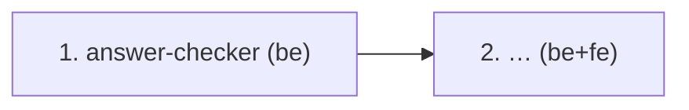

# MVP Capability Change Plan

**Step 4 of the SDD process** — split the MVP into capability slices that the
delivery loop executes one-by-one. Doučko is delivered across **three repos**,
so every slice also names the repo(s) that implement it, and every MVP
requirement names its **owner repo(s)** — the gate scripts read that column.

> Inputs: `docs/product-brief.md`, `docs/requirements.md`, and the product
> specs under `openspec/specs/` (this store). Lives in the docs repo; code
> repos read it through their pinned `contract/` submodule.

## 1. Slicing principles

1. One slice ≈ one cohesive capability, sized to design/build/test/archive as
   a unit **per repo**: a slice that spans repos becomes one implementation
   change per repo (`implement-<capability>-api` in backend,
   `implement-<capability>-ui` in frontend), both citing the same store spec.
2. Contract first — any API a slice needs is added to `api/openapi.yaml` in
   the store (a contract change) BEFORE either code repo starts; both code
   repos then bump their `contract/` pin.
3. Dependency-respecting order — foundations first; no slice depends on a
   sibling shipping after it.
4. One owner slice per requirement (no gaps, no duplicates); one or more
   owner REPOS per requirement (see §5). Domain-bound NFRs travel with their
   domain; cross-cutting NFRs are honored by every slice.
5. Naming: kebab-case; product/contract changes in the store, implementation
   changes in the code repos.

## 2. The capability slices

| # | Slice | Store spec(s) | Repo(s) → change id | MVP FRs | NFRs travelled | Depends on | Parallel |
|---|---|---|---|---|---|---|---|
| 1 | answer-checker | checking | backend → `implement-answer-checker` | … | … | — | parallel-safe |
| 2 | … | … | backend → `implement-…-api`; frontend → `implement-…-ui` | … | … | 1 | serialize (migrations) |

**Parallel** = `parallel-safe` (disjoint modules, no shared migration → may run
concurrently in a worktree) or `serialize` (touches Flyway migrations or a
shared module). Backend and frontend changes of the same slice parallelize
naturally once the contract is pinned.

**Cross-cutting NFRs every change MUST honor:** {{list NFR ids + summary}}.

## 3. Dependency graph

**Critical path:** {{…}}. **Parallelizable:** {{…}}.

## 4. Per-slice scope and exit criteria

### 4.x `<slice>`

- **Scope in:** {{…}}
- **Scope out:** {{explicit exclusions with FR/TC refs}}
- **Contract impact:** {{new/changed endpoints in api/openapi.yaml, store spec deltas}}
- **Definition of done:** {{3-6 objectively checkable bullets per repo, citing NFR budgets}}
- **Risks:** {{ADR-worthy decisions, open questions to resolve before build}}

## 5. Requirement coverage and repo ownership

**Machine-read** by `check-traceability`, `check-acceptance-methods` (code
repos audit only the ids they own) and `check-workspace` (the cross-repo
join). Keep the header `Repo(s)` and one requirement per row. Owner values:
`backend`, `frontend`, `docs` (comma-separated). Every MVP FR and every
tagged MVP NFR needs a row; every declared Verification method must be one
that an owner repo proves (backend: `local-verifiable`; frontend:
`local-verifiable, e2e, recording, vision-verify, a11y, eval`).

| Req | Slice | Repo(s) |
|---|---|---|
| FR-1 | … | backend, frontend |

Total: **{{N}} MVP FRs across {{M}} slices** (no gaps, no duplicates).

## 6. Sequencing

Implement in dependency order. After each archive, in the repo that archived:
`npm run qa:verify`; in the docs repo: `node scripts/check-workspace.mjs`.
Future-Phase work is NOT in this plan.
